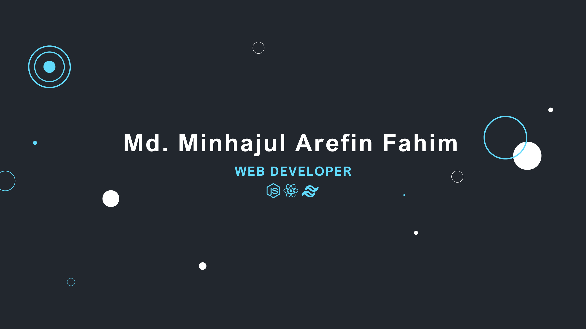

<h1 align="center">Hi, I'm Minhajul Arefin Fahim 👋</h1>

<h3 align="center">
Software Engineer | Full-Stack Developer | React & Next.js
</h3>

## ℹ️ About Me

I'm a Software Engineer with 3 years of software development experience,
specializing in React, Next.js, TypeScript, and Payload CMS, with a solid
foundation in MERN stack development.

I build responsive, SEO-friendly, and performance-optimized web
applications, transforming complex business requirements into
user-friendly digital solutions.

My professional experience includes custom CMS development, dynamic
page builders, caching strategies, third-party API integrations,
and AI-powered conversational applications.

- 💼 Software Engineer at XynoLab
- 📍 Based in Dhaka, Bangladesh
- 🎓 B.Sc. in CSE, United International University
- ⚡ Passionate about performance optimization and scalable architecture
- 🤖 Experienced in developing AI-powered interactive applications
- 🤝 Open to professional opportunities and collaboration
- 📬 minhajul.arefin.fahim@gmail.com
- 📄 [View My Resume](https://drive.google.com/drive/folders/13kfMv2zPc8EX1Y5ihFPnTdRQGuCYGooV?usp=sharing)

## 💼 Professional Expertise

- Full-stack web application development
- Dynamic page builders and content management with Payload CMS
- Next.js data caching and tag-based revalidation
- Image optimization and API cost optimization
- Responsive, pixel-perfect Figma-to-code implementation
- SEO and website performance optimization
- Interactive web animations using GSAP
- AI avatar, voice interaction and ChatGPT integration
- Client communication, code review and mentoring

## 🚀 Featured Projects

### Shanta Life Insurance
[Visit Website](https://shantalife.com/)

A full-featured insurance website with dynamic CMS page management,
bilingual content, interactive premium calculations for 13 insurance
plans, and automated personalized PDF quotations.

### Noe Talk — AI Learning Platform

An interactive learning platform featuring voice-enabled AI avatars
for language practice, powered by Azure and ChatGPT, alongside a
teacher discovery and lesson booking system.

### XynoLab
[Visit Website](https://xynolab.com/)

An interactive corporate website showcasing software solutions,
case studies, articles, and business services.

### Sagar Rope
[Visit Website](https://sagar-rope.com/)

An SEO-friendly manufacturing website showcasing industrial products,
technical specifications, and manufacturing capabilities.

## 🧠 Technical Skills

### Languages & Frontend

  

### Backend & Databases

  

### Development Tools

  

### Additional Expertise

- **CMS:** Payload CMS
- **State Management:** Redux, TanStack Query
- **Animation:** GSAP, ScrollTrigger, Framer Motion
- **Next.js:** App Router, SSR, SSG, ISR, Server Components, Server Actions
- **Backend:** REST APIs, JWT, RBAC, Mongoose
- **Optimization:** Data caching, cache invalidation, image optimization, SEO
- **AI Integration:** Azure services, ChatGPT, conversational AI
- **AI Development Tools:** Claude Code, Codex, Cursor

## 📌 GitHub Statistics

  

  

  
  

  

## 🌐 Connect With Me

  
  
  

